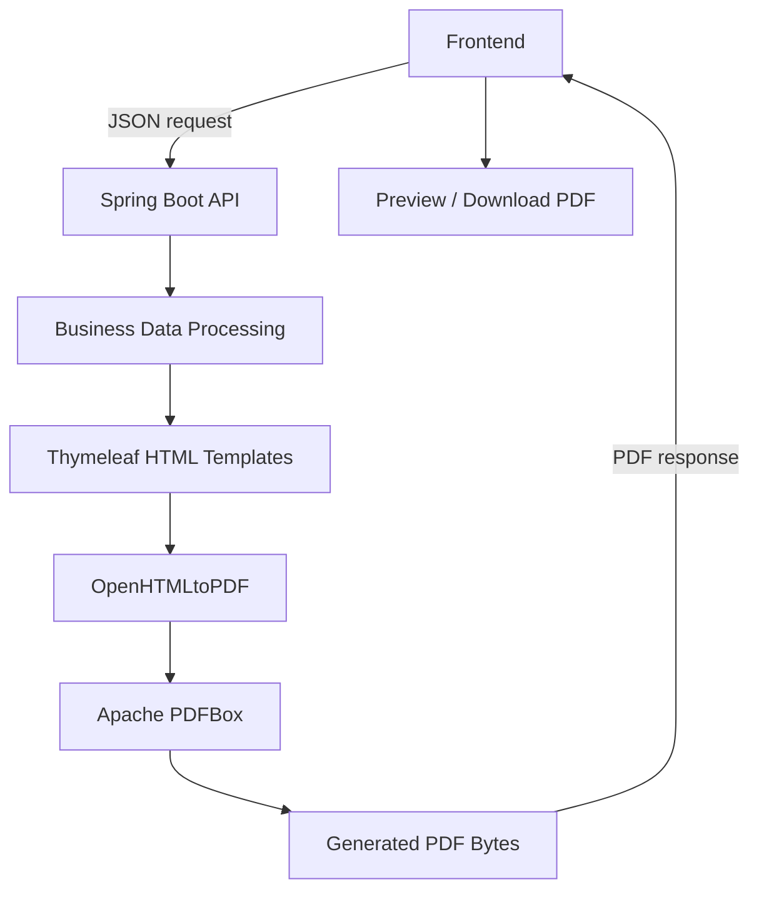

# AutomaticFactus

<p align="center">
  <strong>Automated PDF Generation for Business Documents</strong>
</p>

<p align="center">
  A backend-driven application for generating professional business quotations and invoices using reusable HTML templates and automated PDF rendering.
</p>

<p align="center">
  
  
  
  
  
</p>

---

## Overview

**AutomaticFactus** is a document generation application designed to automate the creation of professional business quotations and invoices in PDF format.

The application centralizes document processing in a Java and Spring Boot backend, transforming commercial data into structured HTML templates and converting them into PDF files.

Instead of manually creating and formatting documents, users can submit the required information and obtain consistently structured PDF documents through an automated workflow.

### Key capabilities

- **PDF Generation:** Automatically generates PDF documents from commercial information.
- **Reusable Templates:** Uses Thymeleaf to render structured HTML document templates.
- **HTML-to-PDF Conversion:** Converts rendered HTML into PDF files using OpenHTMLtoPDF and Apache PDFBox.
- **Document Numbering:** Handles quotation and order numbering.
- **Client Information:** Supports client lookup and registration.
- **REST API:** Exposes endpoints for document generation and supporting operations.
- **Containerized Deployment:** Supports Docker-based execution and automated deployment workflows.

## How It Works

The document generation process is handled by the backend.



### Generation workflow

1. The frontend sends the document information through a REST API request.
2. Spring Boot receives and processes the submitted data.
3. Thymeleaf renders the corresponding HTML template.
4. OpenHTMLtoPDF converts the generated HTML into a PDF document.
5. Apache PDFBox handles the PDF generation process.
6. The backend returns the resulting PDF as binary data to the frontend.

**The PDF is generated entirely on the backend.** The browser only receives and displays the resulting document or allows the user to download it.

## Technology Stack

| Category | Technologies |
| --- | --- |
| Language | Java 17 |
| Backend Framework | Spring Boot 3.3.4 |
| Data Persistence | Spring Data JPA / Hibernate |
| Database | MySQL |
| Template Engine | Thymeleaf |
| PDF Generation | OpenHTMLtoPDF |
| PDF Processing | Apache PDFBox |
| Build Tool | Maven |
| Containerization | Docker |
| CI/CD | GitHub Actions |

## Project Architecture

The application follows a layered backend structure, separating HTTP endpoints, data models, persistence operations, business logic, and document rendering.

```text
src/main/java/com/automaticfactus/
│
├── controller/       # REST API endpoints
├── dtos/             # Request and data transfer objects
├── entities/         # JPA entities
├── model/            # Application models
├── render/           # Document rendering components
├── repositories/     # Database access layer
└── service/          # Business logic
```

Application resources:

```text
src/main/resources/
│
├── application.properties
├── static/
│   ├── form.html
│   └── img/
└── templates/
    ├── layout/
    └── quotation/
```

## API Reference

The application exposes REST endpoints for client operations, document numbering, order processing, and PDF generation.

| Method | Endpoint | Description |
| --- | --- | --- |
| GET | `/health` | Application health check |
| GET | `/api/db-status` | Database connectivity status |
| GET | `/api/clientes/buscar` | Search for a client by identification |
| POST | `/api/clientes/guardarCliente` | Register or update a client |
| POST | `/api/orders/guardarOrden` | Register an order |
| GET | `/api/orders/proximo-numero` | Retrieve the next order number |
| GET | `/api/tipos-identificacion` | Retrieve identification types |
| GET | `/api/tipos-orden` | Retrieve order types |
| POST | `/api/cotizacion` | Generate and return a PDF document |
| GET | `/api/cotizacion/proximo-numero` | Retrieve the next quotation number |

### PDF Generation Endpoint

`POST /api/cotizacion`

Receives document information in JSON format, processes the request, renders the corresponding template, and returns the generated PDF as binary data.

The frontend can use the response to display or download the generated document.

## Getting Started

### Prerequisites

- Java Development Kit 17
- Maven 3.9 or compatible
- MySQL Server
- Docker Engine (optional)

### 1. Clone the repository

```bash
git clone https://github.com/jhonatan0820/AutomaticFactus.git

cd AutomaticFactus
```

### 2. Configure environment variables

The application requires the following environment variables to connect to MySQL:

| Variable | Description |
| --- | --- |
| `URL_MYSQL` | MySQL JDBC connection URL |
| `USER_MYSQL` | Database username |
| `PASS_MYSQL` | Database password |
| `PORT` | Application HTTP port (optional) |

Example configuration:

```dotenv
URL_MYSQL=jdbc:mysql://localhost:3306/automaticfactus
USER_MYSQL=your_username
PASS_MYSQL=your_password
PORT=8080
```

Do not commit credentials or sensitive configuration files to the repository.

### 3. Run the application

Using Maven:

```bash
mvn spring-boot:run
```

The application will start on:

```text
http://localhost:8080
```

### 4. Build the application

```bash
mvn clean package
```

The generated executable JAR will be available in the `target/` directory.

### 5. Run with Docker

Build the image:

```bash
docker build -t automatic-factus .
```

Run the container:

```bash
docker run -d \
  --name automatic-factus \
  -p 8080:8080 \
  -e URL_MYSQL="jdbc:mysql://host.docker.internal:3306/automaticfactus" \
  -e USER_MYSQL="your_username" \
  -e PASS_MYSQL="your_password" \
  automatic-factus
```

Verify the application:

```bash
curl http://localhost:8080/health
```

## Deployment and Infrastructure

AutomaticFactus includes containerization and deployment configuration for different environments.

### Docker

The application uses a multi-stage Docker build:

- Maven with Eclipse Temurin 17 for compilation.
- Eclipse Temurin 17 JRE Alpine for runtime execution.

This reduces the final image size by separating the build environment from the execution environment.

### GitHub Actions

The repository includes a self-hosted deployment workflow:

- `.github/workflows/deploy.yml`

The workflow automates the production deployment process, including:

- Application backup.
- Source code synchronization.
- Docker image build and container deployment.
- Health verification.
- Rollback procedures when deployment checks fail.
- Docker image cleanup.

### Infrastructure

The production infrastructure uses:

- Debian Linux.
- Docker and Docker Compose on the server.
- Nginx.
- Cloudflare Tunnel.
- GitHub Actions self-hosted runner.

Infrastructure configuration and sensitive deployment settings are maintained outside the application repository.

## Security Considerations

- Database credentials are supplied through environment variables.
- Sensitive configuration files are excluded from version control.
- Production and development environments should use independent credentials.
- Deployment secrets must be protected in GitHub Actions and the server.
- Internal infrastructure ports should not be exposed unnecessarily.

## Environments

- **Production:** Deployment environment not publicly documented.
- **Development:** [automaticfactus-dev.dotacioneszambrano.com](https://automaticfactus-dev.dotacioneszambrano.com/)

## Author

**Jhonatan Traslaviña**

Software Developer | Backend Engineering | Automation

- GitHub: [@jhonatan0820](https://github.com/jhonatan0820)
- Repository: [AutomaticFactus](https://github.com/jhonatan0820/AutomaticFactus)

---

<p align="center">
  <sub>Built with Java, Spring Boot, and a focus on process automation.</sub>
</p>
